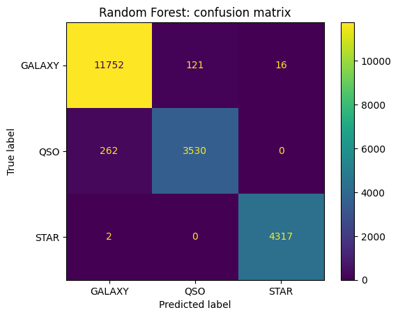
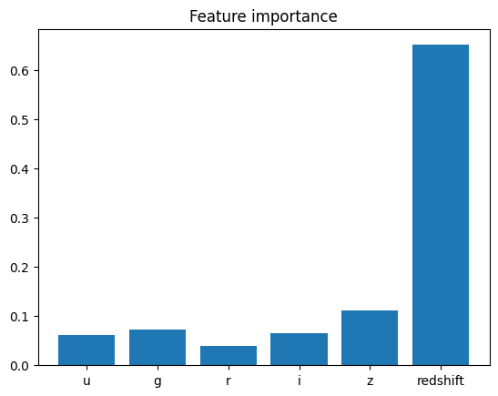

# SDSS Star / Galaxy / Quasar Classification

Machine learning classification of astronomical objects from the Sloan Digital Sky Survey (SDSS): can brightness and redshift measurements tell a **star**, a **galaxy**, and a **quasar** apart?

## Highlights

- Random Forest reached **98.0% accuracy** on 20,000 held-out objects.
- Stars were classified almost perfectly: **4,317 of 4,319** correct.
- A second experiment removed redshift to test how much it matters: accuracy fell to **87.4%**.

## Dataset

[Stellar Classification Dataset - SDSS17](https://www.kaggle.com/datasets/fedesoriano/stellar-classification-dataset-sdss17) on Kaggle, about 100,000 labelled observations of stars, galaxies, and quasars.

- **Features used:** `u`, `g`, `r`, `i`, `z` (brightness in five filters) and `redshift`
- **Cleaning:** rows with invalid measurements (marked -9999) were removed; ID columns were excluded so the model learns from physical measurements only
- **Split:** 80% training / 20% test, stratified by class

## Method

1. Load and clean the data with pandas
2. Train **Logistic Regression** (baseline) and **Random Forest** with scikit-learn
3. Evaluate with accuracy, a confusion matrix, and feature importance
4. Repeat the Random Forest **without redshift** to measure how much it contributes

## Results

| Model | Test accuracy |
|---|---|
| Logistic Regression | 95.78% |
| Random Forest | 97.995% (about 98.0%) |
| Random Forest, no redshift | 87.42% |

Per-class results, Random Forest with redshift (click to expand)

| Class | Test objects | Correctly classified | Recall |
|---|---|---|---|
| Galaxy | 11,889 | 11,752 | 98.8% |
| Quasar | 3,792 | 3,530 | 93.1% |
| Star | 4,319 | 4,317 | 99.95% |

### Confusion matrix

### Feature importance

## What the results show

- **Stars are the easiest class.** Only 2 of 4,319 stars were misclassified.
- **Quasars are the hardest.** 262 of 3,792 quasars were labelled as galaxies, so these two classes overlap the most.
- **Redshift is the dominant feature.** It accounts for roughly 65% of the Random Forest's feature importance (read from the plot). Stars sit at almost zero redshift, while galaxies and quasars are extragalactic, so redshift separates them easily.
- **Brightness alone still carries real information.** Without redshift, accuracy dropped by about 10.6 percentage points but stayed at 87.4%, which is far above chance for three classes.

## How to run it

1. Click the **Open in Colab** button above.
2. Download the dataset from [Kaggle](https://www.kaggle.com/datasets/fedesoriano/stellar-classification-dataset-sdss17) (`star_classification.csv.zip`).
3. Run the cells from top to bottom. When the first cell asks for a file, upload the zip.

No local Python installation is needed.

## Repository contents

- `SDSS17_Star_Classifier.ipynb`: the full notebook with code and outputs
- `confusion_matrix.png`, `feature_importance.png`: result plots

## Limitations

- Results come from a single train/test split, without cross-validation.
- The classes are imbalanced (galaxies are the largest class).
- This is an educational project on a public dataset, not a research result.

## Possible improvements

- Add colour features (u-g, g-r, r-i, i-z), which are physically meaningful
- Add cross-validation, class weights, and hyperparameter tuning
- Try gradient boosting and compare it with Random Forest
- Test the model on other SDSS data releases

## Author

**Memoona Khalid**, BS Computational Physics, University of the Punjab, Lahore, Pakistan.

## Acknowledgements

Dataset on Kaggle by fedesoriano, based on data from the Sloan Digital Sky Survey.